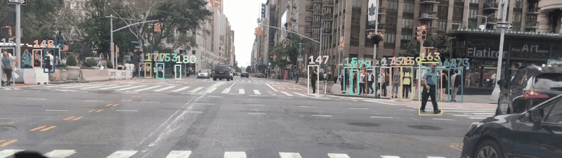
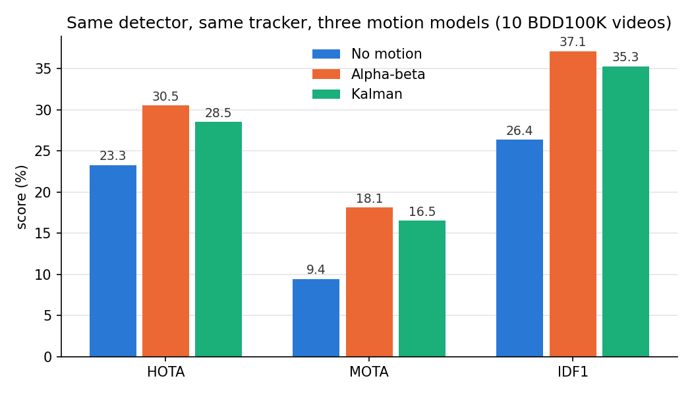
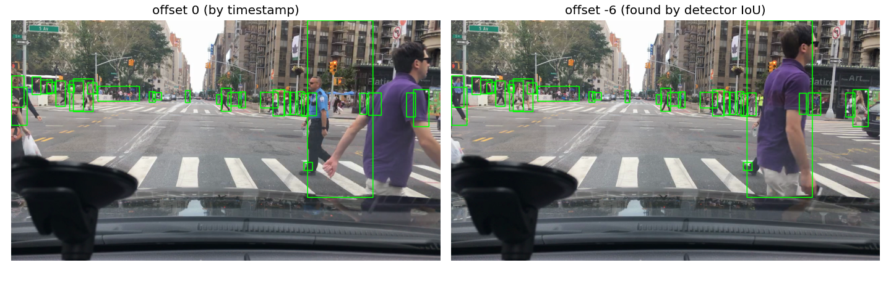
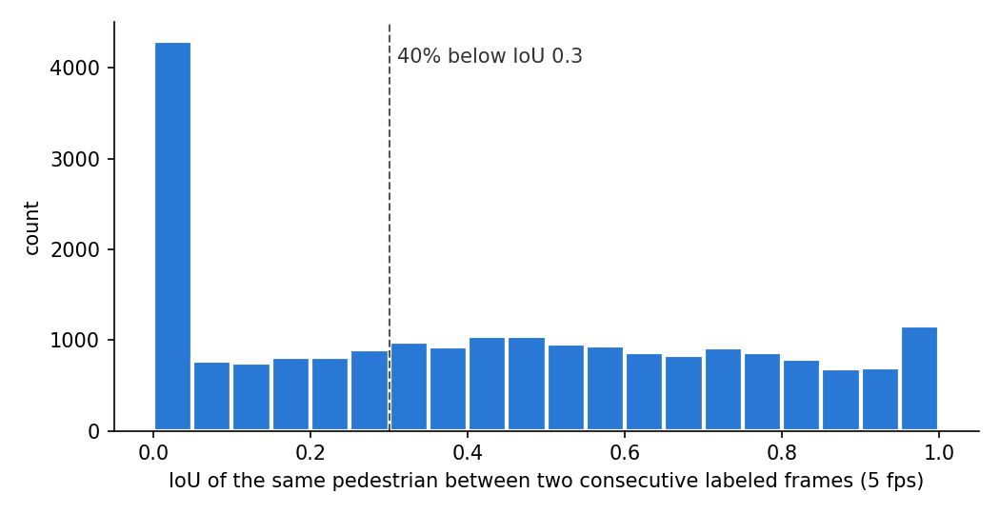

# Pedestrian Tracking in BDD100K Driving Videos: Alpha-Beta vs Kalman

[中文版](README_zh.md)



*The Kalman tracker on a busy crossing in New York (BDD100K `00abd8a7-ecd6fc56`, 5 fps). Each colour is one track ID.*

This project tracks pedestrians in dash-cam videos from BDD100K. It uses my own YOLOv8m pedestrian detector from [P1](https://github.com/asiansumer/yolov8-bdd100k-pedestrian) and a ByteTrack-style tracker that I wrote from scratch in Python. It continues my [MOT17 tracking project](https://github.com/asiansumer/mot17-tracking), where I used alpha-beta and Kalman filters without really understanding them.

So this time I started from the filters themselves. I wrote an alpha-beta filter and a Kalman filter step by step on a simulated 1D car, extended the Kalman filter to an 8-D bounding box, and only then plugged them into a tracker. The tracker code is the same for every run. Only the motion model changes, so the comparison is fair. Every module has pytest tests (23 in total).

## How it works

```
BDD100K MOT labels (5 fps) + 30 fps .mov videos
  -> find the frame offset between labels and video (detector IoU search)
  -> extract the labeled frames, write MOT17-style ground truth
  -> YOLOv8m detects pedestrians in every frame (conf >= 0.1, low-score boxes kept)
  -> every frame:
       predict every track one frame ahead  (no motion / alpha-beta / Kalman)
       round 1: high-score boxes (>= 0.4) <-> all tracks, buffered IoU, greedy
       round 2: low-score boxes <-> confirmed tracks that are still unmatched
       unmatched tracks: lost; deleted after 5 frames (1 s)
       unmatched high-score boxes (>= 0.5): new tracks
  -> TrackEval: HOTA, MOTA, IDF1
```

I built it in seven levels:

| Level | What I built | File |
|---|---|---|
| 1 | 1D car simulator: true positions plus noisy measurements | `sim1d.py` |
| 2 | Alpha-beta filter on the 1D car | `alphabeta.py` |
| 3 | 1D Kalman filter: a static wall first, then position + velocity | `kalman.py` |
| 4 | 8-D Kalman filter for a box `[cx, cy, a, h, vcx, vcy, va, vh]` | `kalman.py`, `box_utils.py` |
| 5 | BDD100K data: label/video alignment, frame extraction, detection | `bdd_io.py`, `scripts/prepare_bdd.py`, `scripts/detect_bdd.py` |
| 6 | ByteTrack-style tracker with three motion models | `tracker.py`, `motion_models.py`, `scripts/run_track.py` |
| 7 | Evaluation and figures | `scripts/evaluate.sh`, `scripts/make_figures.py` |

## Results

10 videos from the BDD100K MOT training set: 2,030 labeled frames and 1,880 pedestrians.

| Motion model | HOTA | MOTA | IDF1 | ID switches | IDs issued |
|---|---:|---:|---:|---:|---:|
| No motion (the box stays where it was last seen) | 23.3 | 9.4 | 26.4 | 3170 | 1389 |
| Alpha-beta (alpha 0.9, beta 0.5) | **30.5** | **18.1** | **37.1** | **1454** | 1689 |
| Kalman, 8-D box state | 28.5 | 16.5 | 35.3 | 1827 | 1519 |



Predicting where each person will be in the next frame cuts ID switches by 42% (Kalman) to 54% (alpha-beta). Alpha-beta beats Kalman here, which surprised me. Finding 5 explains why.

The absolute scores are low. To separate detector errors from tracker errors, I also fed the ground-truth boxes to the tracker as if they were perfect detections:

| Motion model | HOTA with my detector | HOTA with perfect detections |
|---|---:|---:|
| No motion | 23.3 | 52.4 |
| Alpha-beta | 30.5 | 64.4 |
| Kalman | 28.5 | 56.3 |

So both parts limit the result. The detector misses about half of the pedestrians, and even with perfect boxes, matching people from one frame to the next is hard in this data (Finding 2).

## Findings

### Finding 1: the labels and the video are a few frames apart



The Kaggle copy of BDD100K MOT has 30 fps `.mov` videos, but the labels are at 5 fps. Taking every 6th video frame by timestamp gave boxes that were visibly in the wrong place (left image). So for every video I tried offsets from -18 to +6 video frames, ran the detector on three sample frames, and kept the offset where the detector's boxes overlap the labels the most. For the video above, the mean IoU is about 0.28 at offset 0 and 0.55 at offset -6.

The offset is different for every video, so it has to be searched per video:

| Video | Offset (video frames) | Alignment score |
|---|---:|---:|
| 00abd8a7-ecd6fc56 | -6 | 0.55 |
| 000d35d3-41990aa4 | -2 | 0.58 |
| 00699de6-58847872 | -7 | 0.54 |
| 002d290d-90f2bab2 | -7 | 0.35 |
| 007aeb45-c601742b | +2 | 0.46 |
| 01a01af7-76f6a476 | -4 | 0.52 |
| 0204aad7-8ad8ba92 | 0 | 0.60 |
| 02645e20-f0955341 | +2 | 0.40 |
| 000f157f-dab3a407 | -6 | 0.64 |
| 021cb34f-455d80a0 | -5 | 0.62 |

### Finding 2: at 5 fps from a moving car, boxes barely overlap between frames



IoU matching assumes that a person's box in the next frame overlaps their box in this frame. Here that is often false. Across all labeled pedestrians, 40% of consecutive box pairs have IoU below 0.3, and almost 1 in 5 do not overlap at all. There are 0.2 s between labeled frames, the car is moving and turning, and most pedestrians are small (median height 65 px). This is why even perfect detections only reach a HOTA of 52 to 64.

### Finding 3: enlarging the boxes before IoU helps

Because so many pairs don't overlap, I enlarge both boxes by 0.6 times their width and height on each side before computing IoU ("buffered IoU", from the C-BIoU paper). Boxes that are close but not touching can then still be matched.

| HOTA | No buffer | Buffer 0.6 |
|---|---:|---:|
| No motion | 21.8 | 23.3 |
| Alpha-beta | 29.8 | 30.5 |
| Kalman | 26.8 | 28.5 |

The low-score second round still uses normal IoU with a stricter threshold (0.5). About three quarters of the boxes scored 0.1 to 0.4 do not match any labeled pedestrian, so a low-score box is only trusted when it sits right where a confirmed track is predicted to be. On its own it never starts a new track.

### Finding 4: the Kalman noise from ByteTrack is made for 30 fps

ByteTrack sets the Kalman noise from the box height: position std h/20 and velocity std h/160 per frame. Those numbers assume 30 fps. At 5 fps a person moves about 6 times further between frames, so the filter is far too confident in its velocity and learns the real speed too slowly. I made two changes:

- multiply the process noise Q by 4 in standard deviation (16 in variance)
- start each new track with a velocity uncertainty of 0.5 box heights per frame instead of 10/160

| Kalman settings | HOTA | ID switches |
|---|---:|---:|
| ByteTrack noise | 25.3 | 2264 |
| Retuned for 5 fps | **28.5** | **1827** |

This is the same idea as level 3. A large P means "I don't trust my own prediction yet", so the gain K is large and the filter follows the measurements quickly.

### Finding 5: tracks are short, so learning the speed fast matters most

A pedestrian is visible for 12 labeled frames on average (median 8). A filter that needs many frames to learn the speed never gets there. That is why alpha-beta with a large beta wins here:

| Alpha-beta setting | HOTA |
|---|---:|
| alpha 0.75, beta 0.1 | 26.1 |
| alpha 0.9, beta 0.1 | 27.5 |
| alpha 0.9, beta 0.5 | **30.5** |

With beta = 0.5, half of each residual goes into the velocity, so the filter picks up the speed within one or two frames. The Kalman filter can do the same when its initial P is large, but in my tuning it still stayed about 2 HOTA behind.

I first saw this trade-off on the 1D car in levels 2 and 3, where the car started with a wrong speed guess. A slow alpha-beta (alpha 0.1, beta 0.01) never caught up and had a mean position error of 2.68 m. Raw measurements had 0.313 m. The Kalman filter had 0.178 m, because its gain started near 1 and then dropped towards 0.23 as it became confident. A fixed alpha-beta has to choose between fast and smooth, while the Kalman filter changes its gain over time. In this dataset, tracks end before the Kalman filter's advantage in smoothness has time to matter, so fast wins.

## How to run

Python 3.10 with numpy, pandas, pyarrow, opencv-python, ultralytics, matplotlib and pytest. TrackEval runs in a separate environment with numpy < 1.24, cloned next to this repo at `../TrackEval`. The detector weights are expected at `../yolov8-bdd100k-pedestrian/runs/yolov8m_bdd100k_pedestrian.pt` (from the P1 releases).

**Data.** Download from the Kaggle dataset `robikscube/driving-video-with-object-tracking`:

- `mot_labels.parquet` -> `data/bdd_mot/mot_labels.parquet`
- the 10 videos listed in `VIDEOS` in `scripts/prepare_bdd.py` -> `data/bdd_mot/videos/<name>.mov`

**Run.** From the repo root:

```bash
python -m pytest -q                # 23 tests
python -m scripts.prepare_bdd      # find offsets, extract frames, write gt  (~5 min)
python -m scripts.detect_bdd       # detections -> dets/  (default device mps; pass cpu otherwise)
python -m scripts.run_track        # three motion models -> results/
bash scripts/evaluate.sh           # TrackEval, in the numpy < 1.24 environment
python -m scripts.make_figures     # figures/  (or one of: compare frame_iou align gif)
```

The 1D experiments from levels 1 to 3: `python -m scripts.plot_noise`, `python -m scripts.run_alphabeta`, `python -m scripts.run_kalman_static`, `python -m scripts.run_kalman_car`.

## Project structure

```
sim1d.py          1D car: true positions and noisy measurements
alphabeta.py      one alpha-beta step
kalman.py         1D and matrix Kalman steps, box matrices F/H, box noise Q/R, predict/update
box_utils.py      box conversions (x1 y1 x2 y2 <-> cx cy a h) and IoU
metrics.py        mean absolute error for the 1D experiments
bdd_io.py         read BDD labels, write MOT17-style gt and seqinfo, read detections
motion_models.py  no motion / alpha-beta / Kalman, with the same 4 functions each
tracker.py        buffered IoU, greedy matching, ByteTrack-style tracker
scripts/          one script per level, plus evaluate.sh and make_figures.py
tests/            pytest tests
figures/          the figures in this README
```

## Limitations and next steps

- **Tuned on the test set.** The tracker settings were chosen on the same 10 videos they are evaluated on, so the scores are optimistic. A proper split would tune on some videos and report on others.
- **The detector is the biggest limit.** At the tracking threshold it finds about half of the labeled pedestrians, and most of them are small.
- **No appearance features.** At 5 fps with a moving camera, position alone is often not enough to tell people apart. A ReID embedding (as in DeepSORT or BoT-SORT) is the usual fix.
- **No camera-motion compensation.** When the car turns, every box shifts the same way. Estimating that shift from the image (as BoT-SORT does) and removing it before prediction should help both filters.
- **Constant velocity in image space.** A pedestrian near a moving car speeds up in the image as the car gets closer. A motion model on the ground plane would be more realistic.
- **Crowd boxes are ignored** in evaluation, following the official BDD100K rule.
